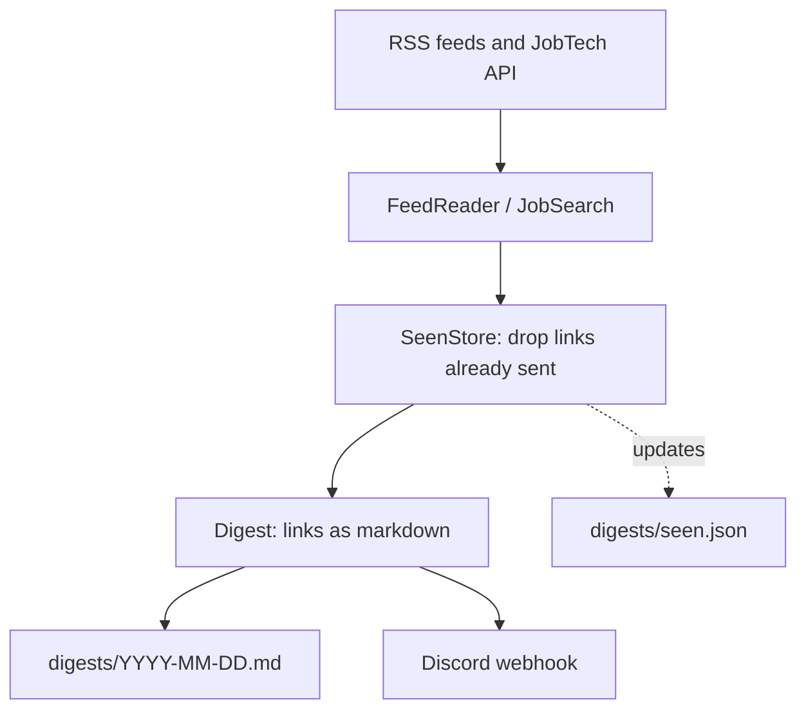

<div align="center">

# dev-digest

**A daily news and job digest, delivered to Discord.**


[Overview](#overview) · [How it works](#how-it-works) · [Getting started](#getting-started) · [Configuration](#configuration) · [Design decisions](#design-decisions) · [Limitations](#known-limitations)

</div>

<!-- Add a screenshot of the Discord message here:

-->

## Overview

dev-digest is a .NET console app that runs every morning on GitHub Actions. It collects fresh headlines and job ads from RSS feeds and an open job API, groups them by source, and posts the result to a Discord channel. Every link is delivered exactly once.

Each digest starts with a verse of the day, followed by the sections below. Each section lists the new links, grouped by source:

| Section | Sources | Notes |
|---|---|---|
| **War and conflicts** | Al Jazeera, BBC Middle East, The Guardian | Iran, USA, Israel and Palestine. Mixed perspectives on purpose, filtered by keywords |
| **Iran** | BBC Persian, Independent Persian, Tehran Times, Press TV | In Persian and English. Independent and state-linked outlets side by side |
| **Sweden** | SVT Nyheter, Dagens Nyheter, The Local Sweden | Swedish and English headlines |
| **DevOps and software development** | Hacker News, dev.to, CNCF, Docker, Kubernetes, .NET Blog, Azure Blog, GitHub Changelog, PostgreSQL | Tuned for a backend and cloud developer |
| **AI worldwide** | Hacker News, Simon Willison, The Verge, MIT Technology Review | Research, products and commentary |
| **New job ads** | Arbetsförmedlingen JobTech API | Junior .NET, cloud and DevOps roles in Gothenburg |

Illustrative shape of one section (not real output):

```markdown
### AI worldwide

**Source name**

* [Some headline](https://example.com/article)

**Another source**

* [Another headline](https://example.com/other)
```

## How it works



1. **Collect.** `FeedReader` parses RSS and Atom feeds and applies keyword filters. `JobSearch` queries the JobTech API.
2. **Deduplicate.** `SeenStore` keeps every link already sent in `digests/seen.json` and drops repeats. Entries are forgotten after 120 days so the file stays small.
3. **Deliver.** `Digest` renders the markdown, which is saved to `digests/` and posted to Discord in several messages split on line breaks, so no link is cut in half.
4. **Persist.** The workflow keeps `seen.json` in the GitHub Actions cache. Nothing is committed.

### Project structure

```
dev-digest/
├── .github/workflows/
│   ├── daily-digest.yml      scheduled run, posts to Discord
│   └── ci.yml                runs the tests on push and pull requests
├── digests/                  seen.json (initial state; later runs use the Actions cache)
├── src/DevDigest/
│   ├── Program.cs            orchestration, about 40 lines
│   ├── Config.cs             sources, keywords, per section instructions
│   ├── FeedReader.cs         RSS and Atom parsing, keyword filtering
│   ├── JobSearch.cs          JobTech API client
│   ├── SeenStore.cs          sent-link memory
│   ├── Digest.cs             renders one section as markdown
│   ├── VerseOfTheDay.cs      verse of the day from OurManna, with a fallback link
│   ├── Discord.cs            message splitting and delivery
│   └── Models.cs             Item and Feed records
└── tests/DevDigest.Tests/    xUnit tests
```

## Getting started

### Prerequisites

* .NET 10 SDK
* A Discord webhook (channel settings, Integrations, Webhooks)

### Run locally

```bash
git clone https://github.com/Megjafari/dev-digest.git
cd dev-digest

export DISCORD_WEBHOOK="..."        # optional
DRY_RUN=1 dotnet run --project src/DevDigest
```

`DRY_RUN=1` writes to `digests-preview/` and leaves `seen.json` untouched, so local testing never affects what the scheduled run sends. Without `DISCORD_WEBHOOK` nothing is posted.

### Deploy on your own fork

1. Fork the repository.
2. Add the secret listed under [Configuration](#configuration).
3. Run the `daily-digest` workflow once from the Actions tab. After that it runs on its own at 06:00 UTC.

The first run sends everything that is current. After that you only get what is new.

## Configuration

| Name | Type | Required | Purpose |
|---|---|---|---|
| `DISCORD_WEBHOOK` | Secret | For delivery | Where the digest is posted |
| `DRY_RUN` | Env var | No | `1` writes to `digests-preview/` and does not update the seen list |

Sources, keywords and job searches all live in `src/DevDigest/Config.cs`.

## Testing

```bash
dotnet test tests/DevDigest.Tests
```

The tests cover the logic that is easiest to get wrong: deduplication and batch limits in `SeenStore`, message splitting in `Discord`, and keyword filtering in `FeedReader`. They run in CI on every push that touches `src/` or `tests/`, and on pull requests.

## Design decisions

* **RSS and open APIs instead of HTML scraping.** More stable, and it avoids terms of service and robots.txt problems.
* **The Actions cache is the storage.** The seen list is a plain file kept in the GitHub Actions cache, so the app needs no database and no hosting and the repository gets no daily commits. If the cache is lost (GitHub evicts entries unused for 7 days), the next run may resend recent items.
* **Graceful degradation.** A failing source is logged and skipped.
* **Small files with one job each.** `Program.cs` only orchestrates.
* **Verse of the day via OurManna.** BibleGateway returns 403 to scripts, so the verse comes from an API that allows it. Only the reference and a link are included, not the text, since the digest markdown can end up in a public repo.

## Cost

Nothing. GitHub Actions is free for public repositories, and the RSS feeds, JobTech and Discord webhooks are free.

## Known limitations

* A source that fails, for example with a 403 from a site that blocks bots, is logged and skipped with no retries.
* The verse of the day comes from OurManna, because BibleGateway blocks automated requests. It is not necessarily the same verse BibleGateway shows. If OurManna is unavailable, a plain link to BibleGateway is used instead.
* Scheduled workflows on GitHub can start 5 to 30 minutes late, and the cron time is in UTC, so the local time shifts by an hour when daylight saving time changes.

## License

Released under the [MIT License](LICENSE).